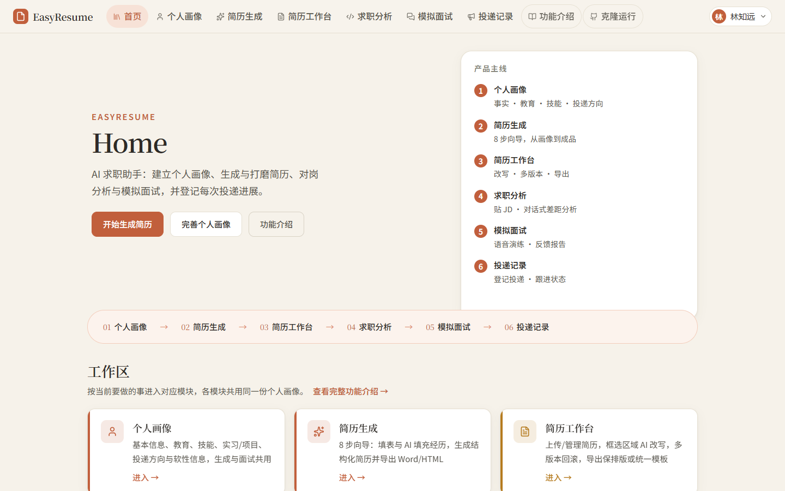

# EasyResume 公开在线预览（GitHub Pages）



这是 **EasyResume** 的公开在线预览：使用真实前端工程构建，界面与交互与源码项目一致；数据为虚构演示人物「林知远」，AI/语音流程为本地 Mock。

公开地址：[https://lzy22301093.github.io/](https://lzy22301093.github.io/)

## 你能在这里看到什么

- **免登录演示账号**：直接进入工作台，无需注册
- **一比一产品界面**：个人画像、简历生成、简历工作台、求职分析、模拟面试、投递记录、功能介绍
- **Mock 用户旅程**：预置画像、多版本简历、匹配任务、面试报告、投递记录
- **AI 预设流程**：点击生成 / 匹配 / 面试会走模拟耗时与预设结果，并提示完整能力需克隆源码
- **克隆运行页**（导航「克隆运行」）：完整功能启动步骤与演示边界说明

## 演示边界

- 不连接 EasyResume 后端、LLM、ASR、TTS、WebSocket 或数据库
- 人物与学校、公司、项目、联系方式、岗位、分数均为虚构
- 不上传、保存或发送访客输入
- 完整能力（真实 LLM、语音面试、导出等）请克隆源码仓库运行

## 完整项目

```text
git clone https://github.com/Lzy22301093/EasyResume.git
cd EasyResume
cp .env.example .env
docker compose up -d
```

- 前端：http://localhost:5173
- 后端 API：http://localhost:8000/docs

## 本仓库如何构建

预览站由真实项目 `frontend/` 在 `VITE_DEMO_MODE=1` 下构建：

```powershell
cd frontend
$env:VITE_DEMO_MODE='1'
npm run build
# 将 dist/ 同步到本仓库根目录并保留 .nojekyll
```

演示模式实现在源码 `frontend/src/demo/`（Mock API / SSE / WebSocket）。

## 隐私

演示联系方式固定为 `resume-demo@example.com` 与 `+86 000 0000 0000`。请勿提交真实个人信息。
